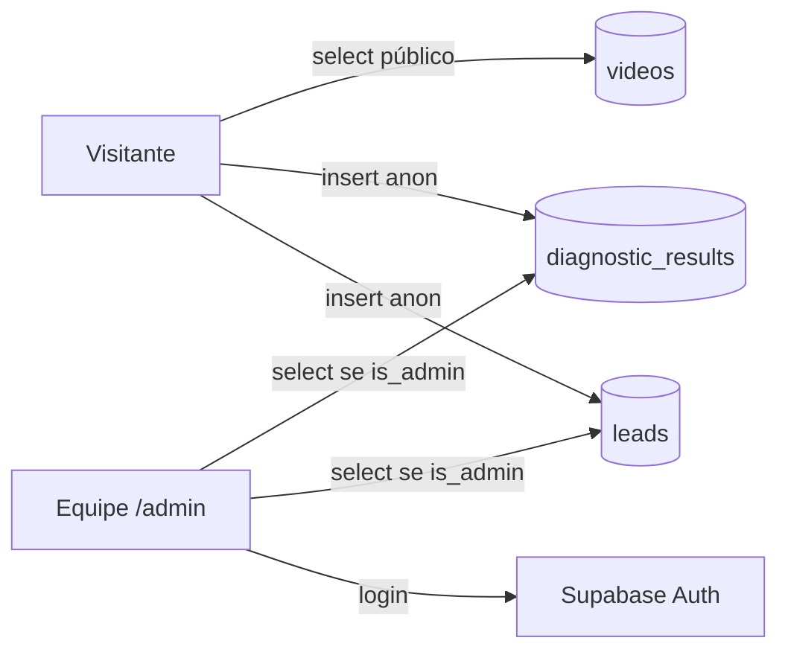

# Yázigi Swiss Park — landing, captação de leads e painel admin

[](https://github.com/devthomaseduardo/yazigi-swiss-park-lp/actions/workflows/ci.yml)

Site da escola de idiomas **Yázigi Swiss Park (Campinas/SP)**. Apresenta cursos e níveis, faz um diagnóstico de inglês em etapas, grava leads e diagnósticos no **Supabase** e tem um painel **/admin** com login para a equipe da unidade acompanhar os contatos.

**No ar:** https://www.yaziswissparkcampinas.com.br

| Desktop | Celular |
|---|---|
|  |  |

## Meu papel

Desenvolvedor full stack do projeto: landing, formulários e validação, persistência e políticas de acesso no Supabase, autenticação do painel, testes e CI.

## O que o projeto resolve

A unidade precisava de um site que não só apresentasse a escola, mas **gerasse contatos rastreáveis**: saber quem pediu informação, por qual seção da página e qual o perfil do aluno antes da primeira ligação.

- **Visitante:** vê cursos, níveis, depoimentos (texto e vídeo) e galeria; chama no WhatsApp ou faz o diagnóstico.
- **Diagnóstico:** modal em etapas (contato validado com Zod + perguntas sobre nível, objetivo, prazo e disponibilidade). As respostas vão para `diagnostic_results` e o contato segue para o WhatsApp.
- **Lead:** cada CTA grava em `leads` com a `source` (seção de origem), o que permite saber o que converte.
- **Equipe:** `/admin` mostra totais do dia e tabelas de leads e diagnósticos.

## Stack

| Camada | Tecnologia |
|---|---|
| Front-end | React 18, TypeScript, Vite, React Router |
| UI | Tailwind CSS, componentes shadcn/ui (Radix), Embla Carousel |
| Dados no cliente | TanStack Query, Supabase JS (cliente tipado) |
| Validação | Zod |
| Back-end | Supabase: Postgres, Auth, Storage e Row Level Security |
| Qualidade | ESLint, `tsc` no CI, Vitest + Testing Library, GitHub Actions |

## Arquitetura



Não há servidor próprio: o navegador fala direto com o Supabase usando a chave pública, e **quem pode o quê é decidido no banco**, por políticas RLS. Detalhes em [docs/ARCHITECTURE.md](docs/ARCHITECTURE.md) e [docs/SUPABASE.md](docs/SUPABASE.md).

## Decisões técnicas

- **Supabase em vez de API própria.** Uma landing com formulário e painel interno não justifica manter um servidor. Postgres + Auth + RLS cobrem o caso com menos peças para operar.
- **Segurança no banco, não no front.** O visitante anônimo só consegue *inserir* em `leads` e `diagnostic_results`. Ler esses dados exige estar logado **e** estar na tabela `admins` (função `is_admin()`), então criar uma conta no Auth não dá acesso aos leads.
- **Tipos gerados do schema.** `src/integrations/supabase/types.ts` descreve as tabelas; um erro de nome de coluna quebra o `tsc` em vez de falhar em produção.
- **Origem do lead (`source`).** Cada ponto de conversão grava de onde veio, para a unidade comparar seções da página.

## Como rodar

Requisitos: Node 20+ e um projeto Supabase.

```bash
git clone https://github.com/devthomaseduardo/yazigi-swiss-park-lp.git
cd yazigi-swiss-park-lp
npm install
cp .env.example .env.local   # preencha URL e chave pública do Supabase
npm run dev                  # http://localhost:8080
```

Banco: aplique as migrações de `supabase/migrations/` (CLI `supabase db push` ou SQL Editor) e cadastre o primeiro admin — veja [docs/SUPABASE.md](docs/SUPABASE.md).

## Scripts

| Comando | O que faz |
|---|---|
| `npm run dev` | servidor de desenvolvimento |
| `npm run build` | gera sitemap e build de produção em `dist/` |
| `npm run lint` | ESLint |
| `npm run typecheck` | checagem de tipos |
| `npm test` | testes (Vitest) |

## Testes

`src/test/` cobre o que mais pode quebrar sem ninguém ver:

- validação do contato do diagnóstico (nome, telefone, e-mail);
- gravação de lead e diagnóstico com as colunas certas, e retorno de erro quando o Supabase recusa;
- `/admin` sem sessão redireciona para `/auth`.

O CI ([.github/workflows/ci.yml](.github/workflows/ci.yml)) roda lint, tipos, testes e build em cada push e PR.

## Estrutura

```
src/
├── pages/                 Index (landing), Auth, Admin, NotFound
├── components/            seções da landing, DiagnosticModal, WhatsApp
│   ├── admin/             estatísticas e tabelas do painel
│   └── ui/                componentes base (shadcn/ui)
├── hooks/                 useLead, useDiagnostic, useVideos
├── lib/                   schemas Zod e utilitários
├── integrations/supabase/ cliente e tipos do banco
└── test/                  testes
supabase/migrations/       tabelas, índices e políticas RLS
scripts/                   sitemap/SEO e upload de vídeos (service role, uso local)
```

## Deploy

Build estático em `dist/`, publicado como SPA (Vercel, Netlify ou similar) com as variáveis `VITE_SUPABASE_*` configuradas no provedor e fallback para `index.html` nas rotas `/auth` e `/admin`.
